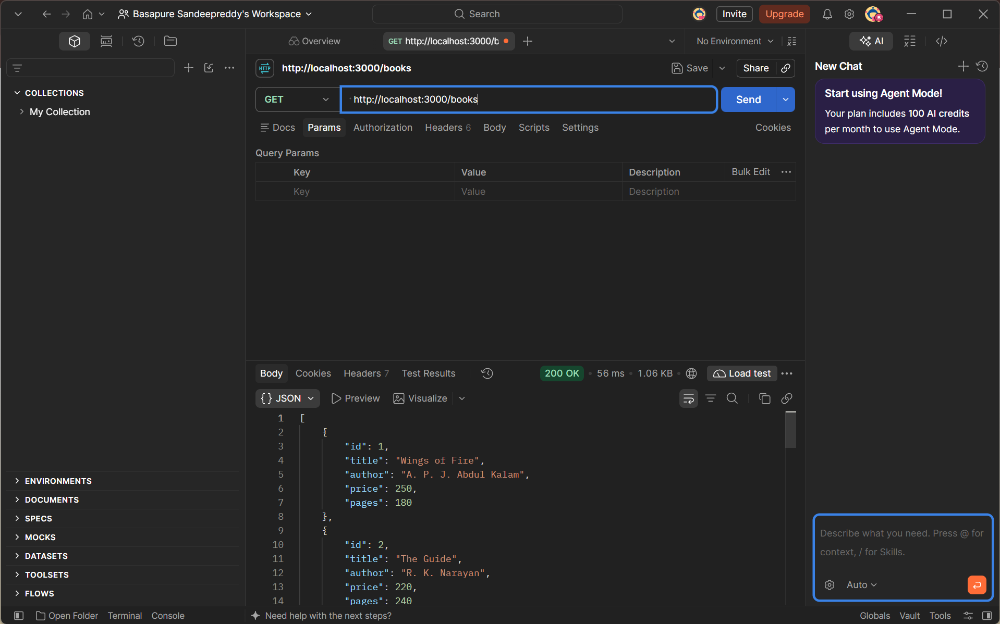
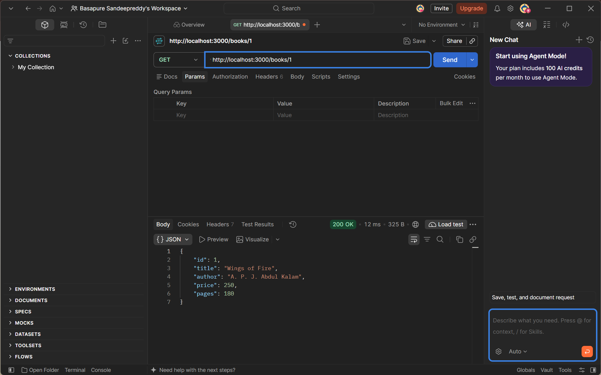
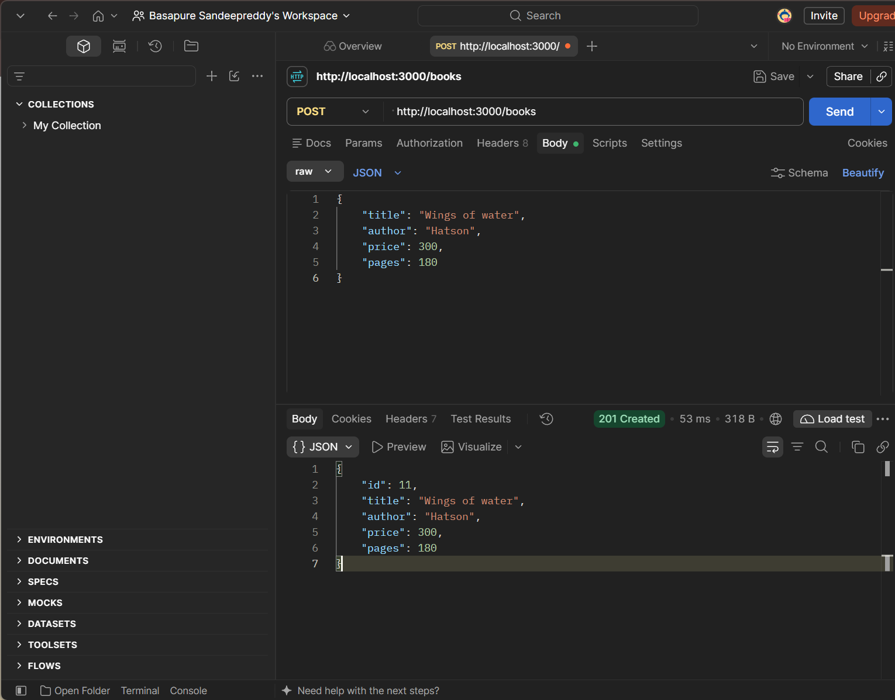
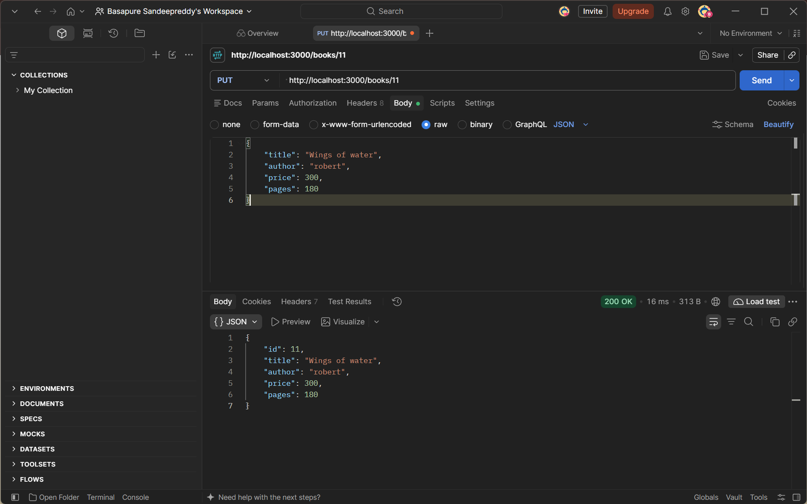
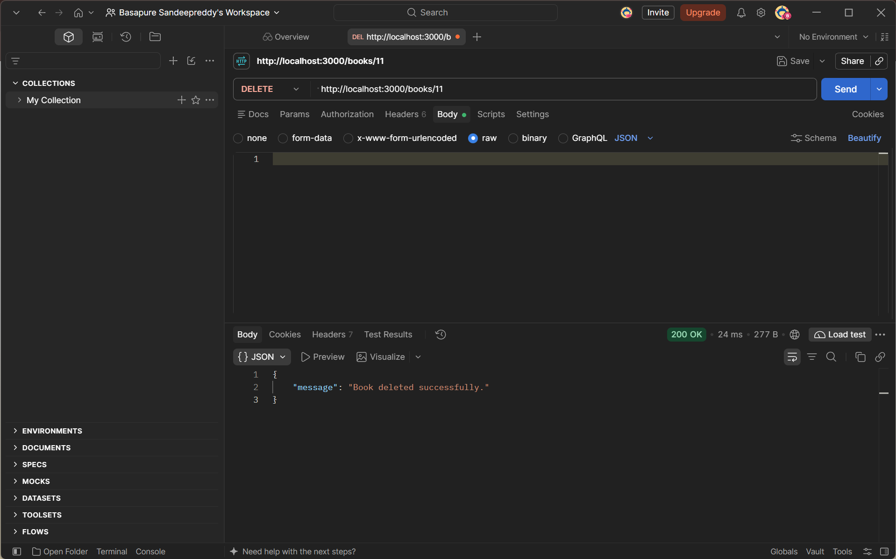
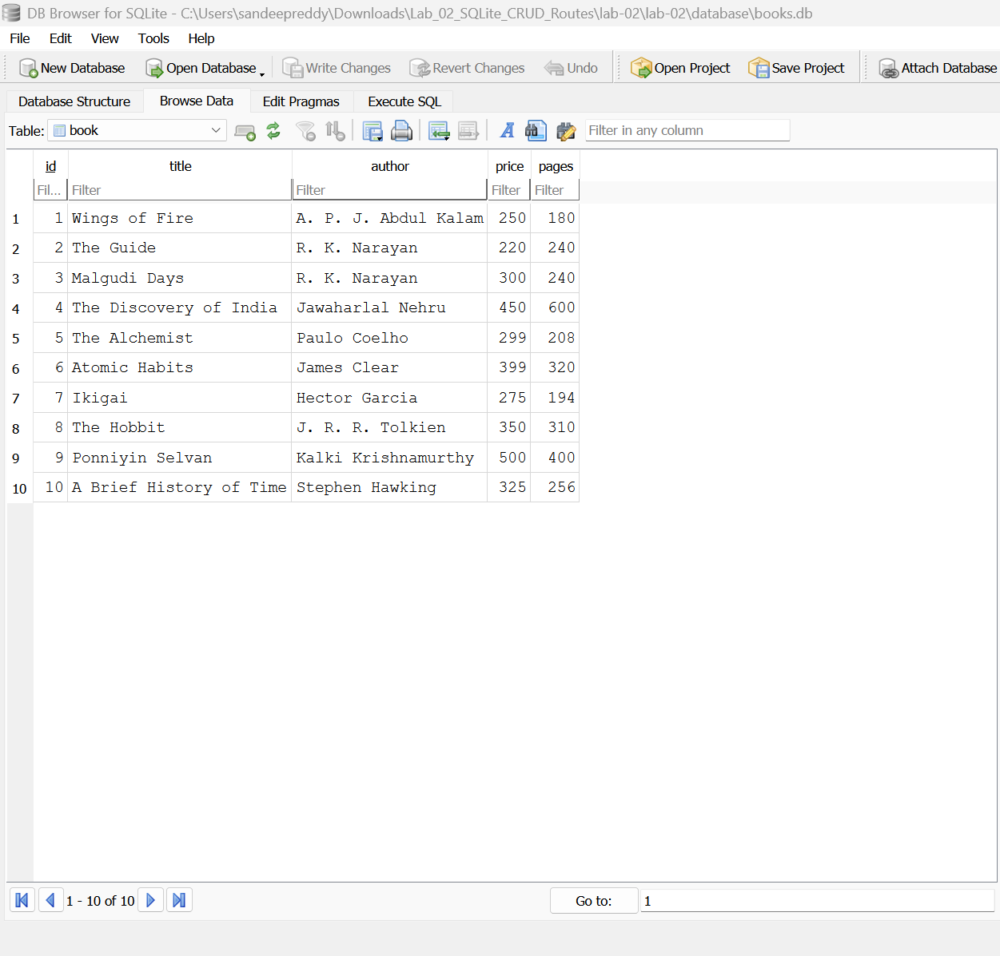

# Lab 2: SQLite database and CRUD routes

**Name:** Sandeep Reddy Basapure  
**Registration number:** 252U1R9016  
**Section:** CSE Gen AI 2A

Live link: https://nodejs-labs-2.onrender.com/books

## Objective

Connect an Express server to a SQLite database and expose five CRUD operations over HTTP.

## Requirements

- Node.js and npm
- Postman
- SQLite CLI (optional, for inspecting the database and running the SQL script)

## Install and run

Open a terminal in the `lab-02/` folder and run:

```bash
npm install
npm run dev
```

Nodemon restarts the server when you change a source file. The server starts at `http://localhost:3000` by default. To use another port, set the `PORT` environment variable before starting the server.

Windows PowerShell example:

```powershell
$env:PORT=3000
npm run dev
```

The supplied `database/books.db` file already contains the `book` table and 10 sample rows. The SQL used to create and seed the table is in `sql/create_books.sql`.

### Re-create the database with SQLite CLI (optional)

If you want to recreate the sample database, first back up or remove `database/books.db`, then run from the `lab-02/` folder:

```bash
sqlite3 database/books.db < sql/create_books.sql
```

Run this command only on a new/empty database file: the seed inserts are intended to run once. To inspect the data:

```bash
sqlite3 database/books.db
```

Then, inside the SQLite prompt:

```sql
.tables
SELECT * FROM book;
.quit
```

## Endpoints

All request paths below are local to `http://localhost:3000`. Requests that send a body should use `Content-Type: application/json`.

| Method | Path | Description | Success status |
|---|---|---|---|
| GET | `/books/` | Get all books | 200 |
| GET | `/books/:bookId/` | Get one book by ID | 200 |
| POST | `/books/` | Add a book | 201 |
| PUT | `/books/:bookId/` | Replace a book's details | 200 |
| DELETE | `/books/:bookId/` | Delete a book | 200 |

The API uses `?` placeholders and parameter arrays for SQL statements that include user input.

## Postman testing

Import `postman/Lab-02-Books-CRUD.postman_collection.json` into Postman. Run the requests against the local server.

1. **GET all books:** `GET http://localhost:3000/books/`
2. **GET one book:** `GET http://localhost:3000/books/1/`
3. **POST a book:** `POST http://localhost:3000/books/`, body → raw → JSON:

   ```json
   {
     "title": "Clean Code",
     "author": "Robert C. Martin",
     "price": 450,
     "pages": 464
   }
   ```

4. **PUT a book:** `PUT http://localhost:3000/books/1/`, body → raw → JSON:

   ```json
   {
     "title": "Wings of Fire - Updated",
     "author": "A. P. J. Abdul Kalam",
     "price": 275,
     "pages": 190
   }
   ```

5. **DELETE a book:** `DELETE http://localhost:3000/books/11/` (if the POST test created ID 11). If the new book receives another ID, use the ID returned by POST.

Test a missing ID such as `/books/99999/` as well; it should return `404`. POST and PUT validation errors return `400`.

After POST, PUT, and DELETE, verify the change with SQLite CLI:

```sql
SELECT * FROM book ORDER BY id;
```

## Screenshots

Upload the actual response screenshots to the `screenshots/` folder and embed them here in GitHub Markdown so they display correctly in the repository.

### GET all books


### GET one book


### POST a book


### PUT a book


### DELETE a book


### SQLite database


## Deployment note

This project uses a local SQLite database file. A deployment platform must provide persistent storage for the database if changes are expected to survive restarts or redeployments. If persistent storage is not configured, deploy only for demonstration and explain the limitation here. Add the public live URL above if you deploy successfully; otherwise keep **Not applicable** and submit screenshots for every endpoint.

## Notes / problems faced

- The database is opened asynchronously before the server begins listening.
- SQL statements use parameterized placeholders to reduce SQL-injection risk.
- `node_modules/` and `.env` are excluded through `.gitignore`.

## GitHub submission checklist

- Put this folder in the course repository as `lab-02/` alongside `lab-01/`, `lab-03/`, and other labs.
- Make the repository public or share it with the faculty.
- Include this README, source code, the `.db` file, and actual screenshots.
- Do not commit `node_modules/` or `.env`.
- Commit regularly with meaningful messages.
