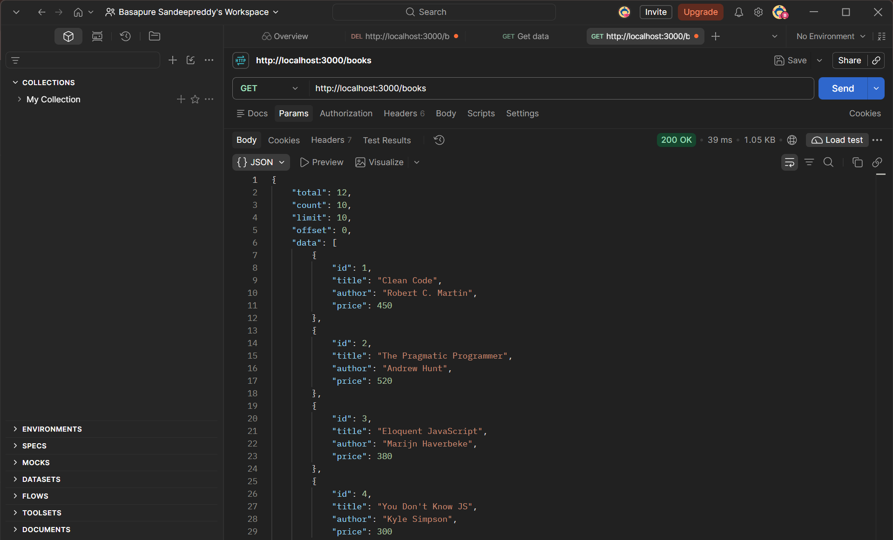
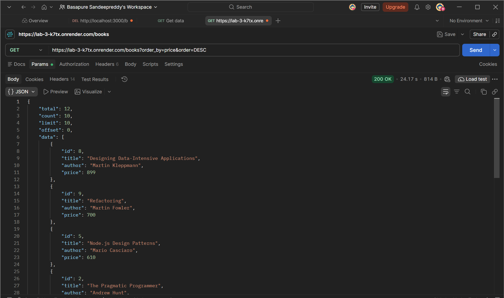
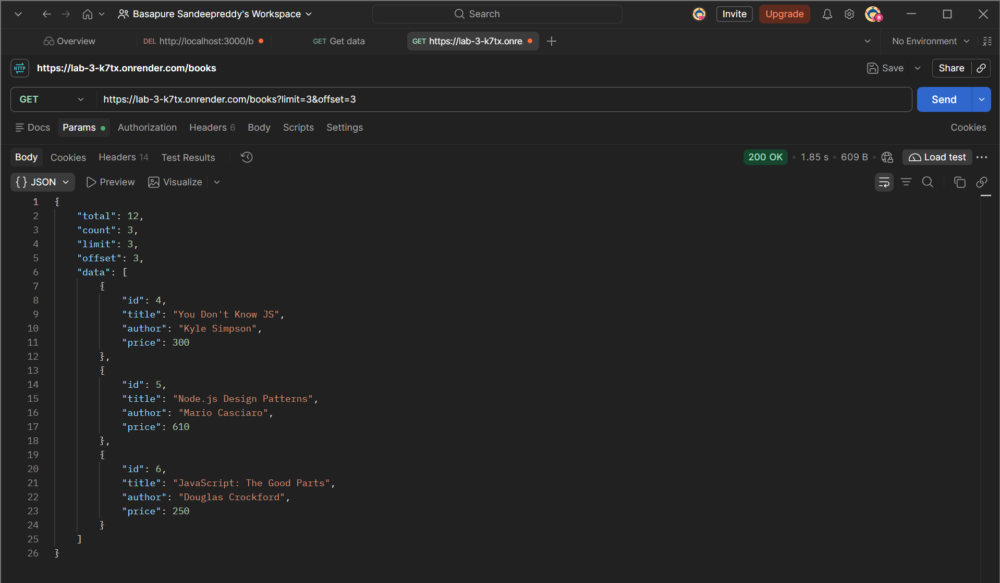
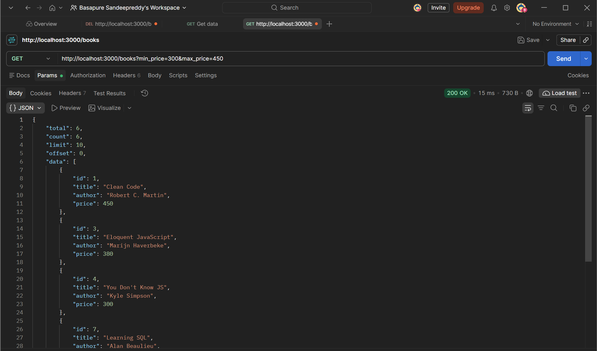
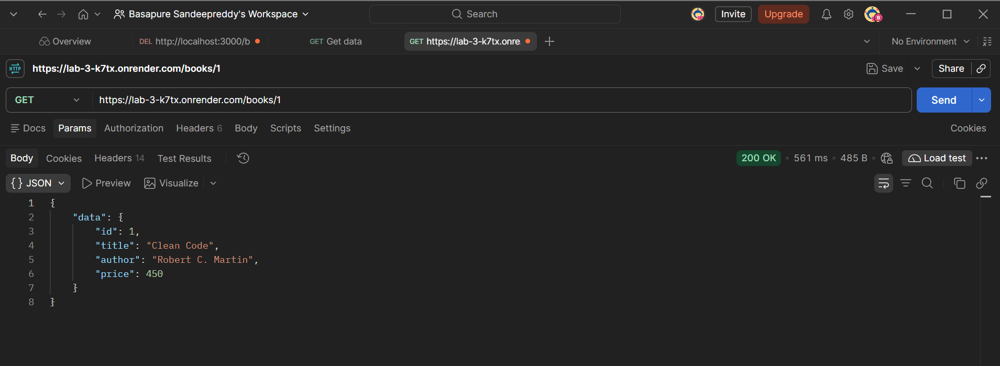
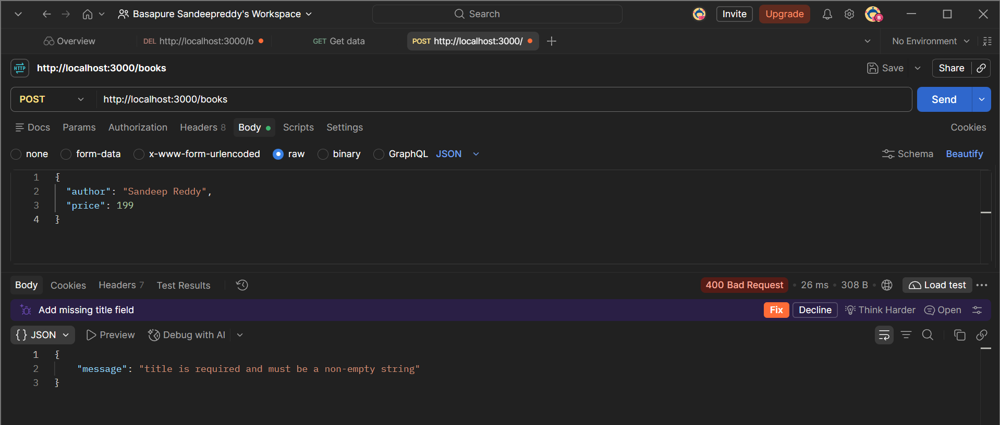
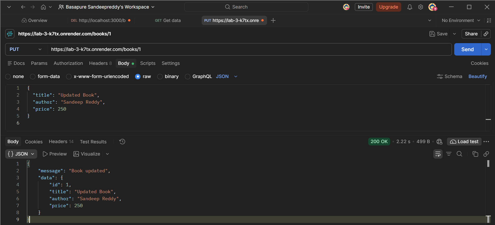

# Lab 3: REST API – Query Parameters, Validation and Debugging

**Name:** Basapure Sandeep Reddy  
**Registration Number:** 252U1R9016  
**Section:** CSE GEN AI 104

## Live Deployment

https://lab-3-k7tx.onrender.com

## Project Description

This project demonstrates a REST API built with Node.js, Express.js, and SQLite. It includes CRUD operations for books, query parameter filtering, validation, debugging practice, and deployment-ready API structure.

## Core Features

- GET all books
- Search books by keyword
- Sort books by field and order
- Pagination with limit and offset
- Price-based filtering
- Fetch a single book by ID
- Create a new book with validation
- Update an existing book
- Delete a book
- Handle errors like invalid input and missing records

## API Testing Screenshots

### 1. GET All Books
**Endpoint:** GET /books

Displays all available books.

### 2. Search Books
**Endpoint:** GET /books?search_q=sql

Searches books using a keyword.

### 3. Sort Books
**Endpoint:** GET /books?order_by=price&order=DESC

Sorts books by price in descending order.

### 4. Pagination
**Endpoint:** GET /books?limit=3&offset=3

Displays a limited number of books.

### 5. Price Filter
**Endpoint:** GET /books?min_price=300&max_price=450

Filters books based on minimum and maximum price.

### 6. GET Book by ID
**Endpoint:** GET /books/1

Retrieves a single book using its ID.

### 7. POST – Input Validation
**Endpoint:** POST /books

Tests validation when the required title field is missing. Expected response: 400 Bad Request.

### 8. PUT – Update Book
**Endpoint:** PUT /books/1

Updates an existing book. Expected response: 200 OK.

### 9. DELETE – Delete Book
**Endpoint:** DELETE /books/1

Deletes an existing book. Expected response: 200 OK.

### 10. GET – Book Not Found
**Endpoint:** GET /books/9999

Tests error handling when a book ID does not exist. Expected response: 404 Not Found.

## Technologies Used

- Node.js
- Express.js
- SQLite
- Postman
- Render

## Conclusion

This lab helped me understand REST API development, CRUD operations, query parameters, input validation, debugging, and deployment workflow in a real backend project.
